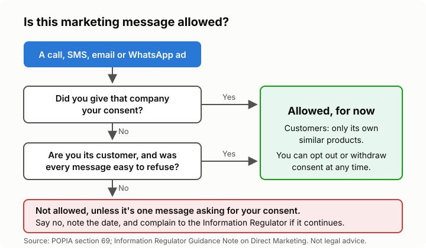

# Lesson 3: Stopping spam calls, SMSes and emails
<!-- facts: Direct marketing rules; National Opt-Out Registry -->

## By the end, the learner can

- Say when a company may send them marketing by call, SMS, email or WhatsApp, and when it may not.
- Opt out of marketing from a company, and know what every marketing message must include.
- Explain the National Opt-Out Registry, and what it can't do.
- Tell a marketing message from a scam.

## Key ideas

**Electronic marketing needs your permission.** A company may only market to you by SMS, email,
automated calls and other electronic messages if you consented, or you're already its customer.
The Regulator's view is that ordinary phone calls and WhatsApp-style messages count too
(`facts.md`).

**They may ask once.** A company you've never dealt with may contact you **one time** to ask for
consent. If you say no, that's the end of it.

**The customer exception is narrow.** If you bought from them, they may market their own similar
products, but only if they offered you a free, easy way to refuse when they took your details and
in every message since.

**Every marketing message must say who sent it and how to make it stop.** Reply "STOP" or use the
opt-out link if it's a company you know. If a message has no sender and no opt-out, that is itself
a breach.

**You can object at any time.** Even for leaflets and other non-electronic marketing.

**The National Opt-Out Registry** is a free government list run by the National Consumer
Commission. It is being phased in; see `facts.md` for dates. It doesn't block calls, and scammers
ignore it. Not being on it never means you consented.

**Scams are not marketing.** Never click links or give an OTP, password or bank detail to anyone
who calls or messages you. Opting out of a scam just confirms your number works: block it instead.

## Worked example

Sipho gets three calls a week selling funeral cover from a company he has never used. He asks the
caller for the company name and where they got his number, says he does not consent, and writes
the date down. The calls continue, so he complains to the Regulator (lesson 6), and registers on
the opt-out registry.

## Exercise

Give the learner three short made-up messages: a store they shop at with an opt-out link; an
unknown insurer with no opt-out; a "bank" asking for an OTP. Ask which is allowed, which breaks
the rules, and which is a scam.

## Sources

- [Information Regulator: Guidance Note on Direct Marketing](https://inforegulator.org.za/wp-content/uploads/2020/07/GUIDANCE-NOTE-ON-DIRECT-MARKETING-IN-TERMS-OF-THE-PROTECTION-OF-PERSONAL-INFORMATION-ACT-4-OF-2013-POPIA.pdf)
- [NCC launches National Opt-Out Registry](https://www.gov.za/news/media-statements/national-consumer-commission-launches-national-opt-out-registry-07-oct-2026)
- [NCC eService portal](https://eservice.thencc.org.za/)
