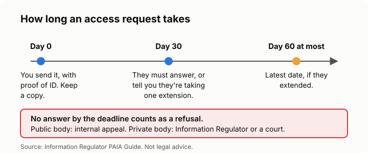

# Lesson 4: Asking a company what it knows about you
<!-- facts: Access requests -->

## By the end, the learner can

- Ask an organisation whether it holds their information, and for a copy.
- Write the request step by step, with PAIA Form 2 or a letter.
- Say what it may cost, how long the organisation has, and what silence means.
- Say what to do if they are refused or ignored.

## Key ideas

**This is often called a "data subject access request".** POPIA gives you the right to ask; PAIA
(the Promotion of Access to Information Act) sets out the procedure and forms.

**Two questions, two prices.** Asking "do you hold information about me?" is free. Asking for the
record itself, and who it has been shared with, may cost a fee; the organisation must give you a
written estimate first. Fees are in `facts.md`.

**Steps:**
1. Find the organisation's **PAIA manual** (usually linked at the bottom of its website). It names
   the information officer and how to send requests.
2. Fill in **PAIA Form 2**, or write a short letter. Say exactly what you want: "all personal
   information you hold about me, its source, and every third party it was shared with".
3. Attach proof of identity, as the manual asks. Send it by email and keep the sent copy.
4. Write the date down. Count 30 days (`facts.md`). They may extend once, and must tell you.
5. Check what you get. If something is wrong, ask for a correction (lesson 2).

**No answer in time counts as a refusal,** which you can challenge.

**If refused or ignored:** for a public body (a municipality, a department), lodge an internal
appeal first. For a private company there's no internal appeal: complain to the Information
Regulator (lesson 6) or go to court. Deadlines are in `facts.md`.

**They may refuse some parts** (other people's information, for example), but must give you the
rest.

## Worked example

Ayesha keeps getting calls from a debt collector about an account she doesn't recognise. She
emails PAIA Form 2 to the collector's information officer, asking what it holds, where it got her
details and who it shared them with. Thirty days pass with no reply, so she complains to the
Regulator and attaches her sent email.

## Exercise

Ask the learner to pick one company that has their details, then find its PAIA manual together
(or describe how they would). Draft the request with placeholders such as `[your name]` and
`[your ID number]`, and ask them to work out the 30-day date from today.

## Sources

- [Information Regulator: PAIA forms](https://inforegulator.org.za/paia-forms/)
- [Information Regulator: PAIA Guide](https://inforegulator.org.za/wp-content/uploads/2020/07/PAIA-Guide-English_20210905.pdf)
- [Protection of Personal Information Act, section 23](https://www.gov.za/documents/protection-personal-information-act)
