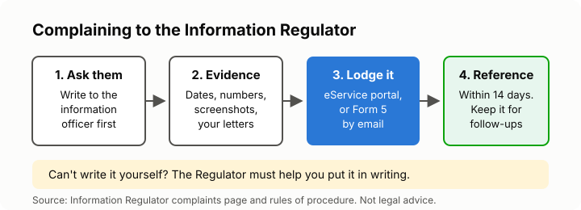

# Lesson 6: Complaining to the Information Regulator
<!-- facts: The Information Regulator; Complaints -->

## By the end, the learner can

- Say when to complain to the Information Regulator.
- Lodge a complaint step by step, online or with Form 5.
- Gather the evidence that makes a complaint strong.
- Say what happens after they complain.

## Key ideas

**When to complain:** your information was shared, leaked or collected without a lawful reason;
an organisation ignored your request to see, correct or delete it; or marketers keep contacting
you without consent or after you opted out. There is a separate route for refused PAIA requests
(lesson 4).

**Try the organisation first,** in writing, unless that's pointless (an anonymous spam caller).
It gives them a chance to fix it, and gives you evidence.

**Steps:**
1. **Gather evidence:** dates and times of calls, screenshots of SMSes and emails, the numbers
   used, copies of your requests and any replies.
2. **Lodge it** on the Regulator's online eService portal (register a profile first), or fill in
   **Form 5** and email it to the POPIA complaints address. Addresses are in `facts.md`.
3. **Say clearly** who did what, when, and what you want (for example, that the calls stop).
4. **Keep your reference number.** The Regulator should acknowledge you within 14 days.

**Can't write it yourself?** The Regulator must help you put a complaint in writing. Call its
toll-free number (`facts.md`).

**What happens next:** the Regulator may investigate, try to settle it, or issue an enforcement
notice. It can fine organisations heavily (`facts.md`). It can also decide to take no action,
for example if too much time has passed or the complaint is trivial, but it must tell you why.

**Suing for damages** is a separate step, through the courts, for which you would need an
attorney.

## Worked example

After lesson 3, Sipho kept a list: 14 calls in a month from the same insurer, the dates, and his
note that he refused consent on the first call. He registers on the eService portal, lodges a
direct marketing complaint with the list and two screenshots attached, and saves his reference
number.

## Exercise

Ask the learner to describe a real or made-up privacy problem, then list what evidence they would
collect and draft the "what happened" part of a complaint, with placeholders for personal details.

## Sources

- [Information Regulator: Complaints](https://inforegulator.org.za/complaints/)
- [Information Regulator: Contact us](https://inforegulator.org.za/contact-us/)
- [Rules of procedure for POPIA complaints](https://inforegulator.org.za/wp-content/uploads/2020/07/20211012-InfoReg-RulesOfProcedure-HandlingPOPIAcomplaints-1.pdf)
